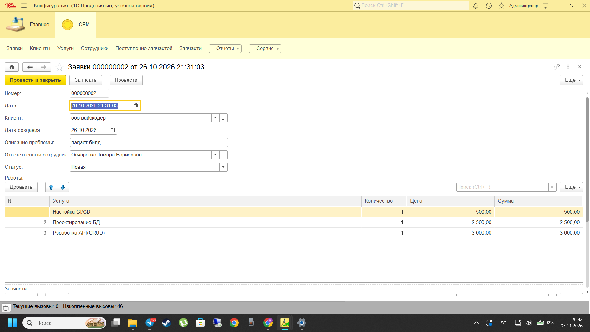
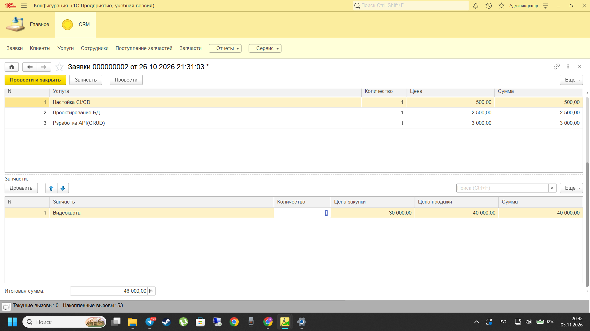
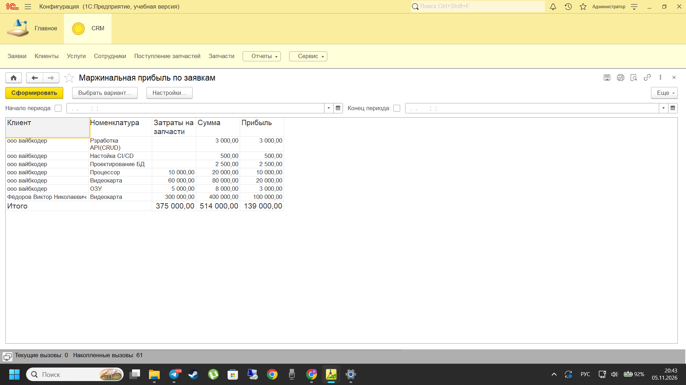
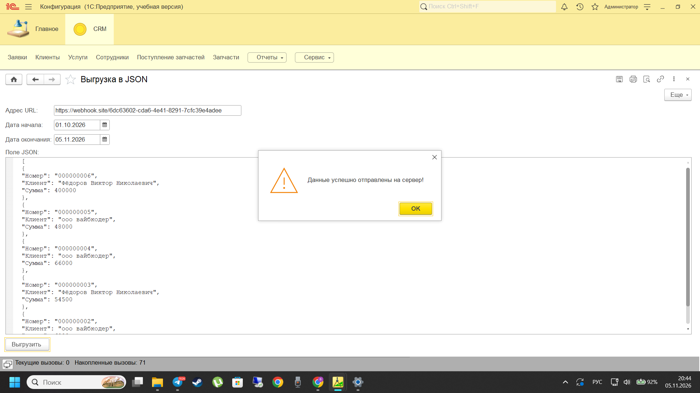

# 🛠 1C Mini-CRM для IT-сервиса

Учебный (pet) проект, представляющий собой полноценную конфигурацию на платформе **1С:Предприятие 8.3**. 
Система предназначена для автоматизации бизнес-процессов небольшого IT-сервиса: учета клиентов, обработки заявок, списания запчастей со склада, расчета маржинальной прибыли и интеграции с внешними системами через HTTP/JSON.

## 🚀 Ключевой функционал

### 1. Учет и НСИ (Справочники)
*   **`Клиенты`:** учет контактных лиц (табличная часть), валидация email.
*   **`Сотрудники`:** справочник ответственных лиц.
*   **`Услуги`:** номенклатура услуг с фиксированными ценами.
*   **`Запчасти`:** учет цен закупки (себестоимость) и цен продажи.

### 2. Документы и бизнес-логика
*   **`Заявки`:** главный документ системы. Содержит табличные части «Работы» (услуги) и «Запчасти».
    *   Реализован автоподбор цен при выборе номенклатуры.
    *   Автоматический пересчет сумм в строках и итоговой суммы документа.
    *   Контроль заполнения строк.
*   **`ПоступлениеЗапчастей`:** документ для пополнения склада.

### 3. Складской и финансовый учет (Регистры накопления)
*   **`ЗапчастиНаСкладе`** (вид: Остатки): контроль остатков перед проведением документа `Заявки`. Если запчастей не хватает, проведение блокируется (выдается сообщение об ошибке).
*   **`Выручка`** (вид: Обороты): управленческий учет, аккумулирует данные по выручке и себестоимости в разрезе клиентов и номенклатуры.

### 4. Отчетность (СКД)
*   **`МаржинальнаяПрибыльПоЗаявкам`:** отчет на базе СКД. Считает выручку, прямые затраты на запчасти и чистую маржу по каждому клиенту.
*   **`ВедомостьОстатковНаСкладе`:** отчет по текущим остаткам запчастей.

### 5. Интеграция
*   Разработана внешняя обработка для **выгрузки документов `Заявки` за выбранный период в формат JSON**.
*   Настроена отправка сформированного JSON на внешний сервер методом **HTTP POST** (с использованием `HTTPСоединение` и `ЗащищенноеСоединениеOpenSSL`).
*   Адрес API выведен в интерфейс обработки для гибкости тестирования.

### 6. Интерфейс и права доступа
*   Настроена подсистема `CRM` с логичным командным интерфейсом.
*   Разработан **Дашборд (Рабочий стол)** с ключевыми показателями (KPI): выручка за текущий месяц и количество заявок.
*   Настроены роли: `Администратор` (полные права) и `Менеджер` (запрет на удаление документов, только пометка на удаление).

## 🧠 Архитектурные решения
*   Вся бизнес-логика вынесена из модулей форм и документов в **общие серверные модули** (`УправлениеСкладом`, `УправлениеФинансами`, `ИнтеграцияСервер`) согласно принципу единственной ответственности (SRP).
*   Реализовано клиент-серверное взаимодействие с использованием `&НаКлиенте`, `&НаСервере`, `РеквизитФормыВЗначение` и `ЗначениеВРеквизитФормы`.
*   Использование языка запросов для сложной аналитики и проверок перед записью.

## 📸 Скриншоты

### Рабочий стол (Дашборд)

### Документ «Заявки» (Шапка и Услуги)

### Документ «Заявки» (Использованные запчасти)

### Отчет по маржинальной прибыли

### Интеграция (Формирование JSON)

### Успешная отправка (Ответ сервера 200 OK)

## 🛠 Стек технологий
*   1С:Предприятие 8.3
*   Язык запросов 1С, Система компоновки данных (СКД)
*   HTTP/HTTPS, JSON (сериализация/десериализация)
*   Git (GitHub Desktop)

---
*Автор: [Vitekvn01]*

